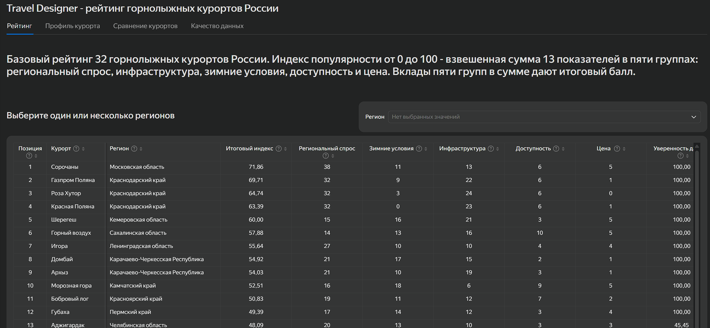

# Travel Designer - рейтинг горнолыжных курортов России

Составной рейтинг 32 горнолыжных курортов в 20 регионах России. Прямой
статистики посещаемости каждого курорта в открытом доступе нет, поэтому рейтинг
собирается из нескольких источников: региональный спрос (Росстат/ЕМИСС),
инфраструктура вокруг курорта (OpenStreetMap), климат за 5 зимних сезонов
(ERA5 через Open-Meteo), ближайшие аэропорты и ЖД, цены ски-пассов (ручной
сбор с верификацией). Рейтинг показывает потенциал курорта по доступным
данным, а не качество отдыха; рядом с каждым местом - оценка уверенности
в данных и флаги качества.

## Быстрый запуск

```
python -m venv .venv
source .venv/Scripts/activate      # Git Bash на Windows (linux: .venv/bin/activate)
pip install -r requirements.txt
python src/run_all.py
```

Последняя команда пересобирает весь конвейер из сохраненных raw-файлов:
prepared-таблицы -> витрина `data/mart/resort_features.csv` ->
рейтинг `data/mart/resort_scores.csv` (около 15 секунд), с автопроверками
на каждом шаге. Ноутбуки в `notebooks/` - исследовательский журнал с теми же
числами и текстовыми выводами; сверка "скрипт = блокнот" описана ниже
в разделе "Витрина и рейтинг".

## Результаты рейтинга

* Базовый рейтинг согласно ТЗ: топ-5 - Сорочаны 71.86, Газпром Поляна 69.71,
  Роза Хутор 64.74, Красная Поляна 63.39, Шерегеш 60.00.
* Сценарные рейтинги меняют позиции курортов под человека: хардкор-лыжник - Чегет
  (88.7, в базе только 15-й), семья с детьми - Газпром Поляна (73.0),
  отдыхающий без лыж - Горный воздух (90.7).
* Устойчивость: увеличение любой группы весов на 20% не меняет четверку
  лидеров; максимальный сдвиг внутри топ-10 - 2 места.

## Дашборд

Интерактивная версия рейтинга - Yandex DataLens - https://datalens.yandex/p1ew7vmw49jc8?_share_link=public *в процессе редактирования*

Четыре вкладки: 
1. Таблица рейтинга с фильтром по региону
2. Профиль курорта с картой
3. Сравнение двух курортов
4. Качество данных. 
Дашборд ничего не считает сам - источник единственный, `data/mart/resort_scores.csv`, пересобранный конвейером. 



## Структура проекта

```
assets             дополнительные изображения
data/raw/          исходные файлы и датированные слои сбора (не перезаписываются)
data/manual/       ручные сборы (цены, опции трасс) + метаданные с родословной
data/prepared/     очищенные таблицы по источникам
data/mart/         витрина resort_features + итоговый resort_scores
src/               collect_* (загрузчики, сеть) и fix_* (разовые фиксы слоя)
src/transform/     очистка, агрегации и сборка витрины
src/scoring/       расчет баллов и рейтинга
src/run_all.py     полный конвейер одним запуском
tests/             проверки данных, формул и соединений
notebooks/         исследовательский журнал (02 витрина, 03 скоринг)
data_dictionary.md словарь данных всех таблиц проекта
README.md          этот файл
```

## Витрина и рейтинг (этап 5 ТЗ)

### Витрина resort_features

Ноутбук `notebooks/02_build_resort_features.ipynb` - журнал сборки витрины:
8 источников соединяются в одну строку на курорт (32 x 43), с проверками
после каждого соединения и картой пропусков. Скрипт
`src/transform/build_resort_features.py` делает тот же расчет кодом;
результат двух путей совпадает байт-в-байт.

### Рейтинг

`notebooks/03_scoring.ipynb` - расчет рейтинга с текстовыми выводами, 4 главы:

1. **Баллы.** Пять функций перевода показателей в шкалу 0-100 (min-max,
   log min-max, обратный log min-max, линейная с ограничением, порог) плюс бинарные
   0/1 x 100; словарь скоринга с обоснованием выбора шкалы для каждого
   показателя.
2. **Базовый рейтинг.** 13 показателей с весами согласно ТЗ (сумма 100), итоговый
   индекс, места; уверенность в данных (confidence) и флаги качества;
   полная проверка по ТЗ и стресс-тест "каждая группа весов +20%".
3. **Сценарные рейтинги.** Три персонажа (хардкор-лыжник, семья с детьми,
   отдыхающий без лыж) - те же баллы с другими весами, только 29 работающих
   курортов. 
4. **Ответы на 7 исследовательских вопросов ТЗ** - с расчетами влияния
   показателей и вкладов групп.

### Рейтинг: скрипт и итоговая таблица

`src/scoring/build_resort_scores.py` повторяет расчет блокнота одним
запуском и пишет `data/mart/resort_scores.csv` (32 строки x 60 колонок):
исходные показатели, 13 базовых баллов, 5 укрупненных компонентов, итоговый
индекс, место, confidence_score, quality_flags, 9 сценарных баллов и итоги
с местами трех персонажей. Автопроверки ТЗ и сверка с контрольными числами
блокнота выполняются при каждом запуске; при любом расхождении скрипт
останавливается.

### Два независимых пути - главный аргумент воспроизводимости

Блокнот и скрипт писались отдельно и реализуют одни и те же правила на одних
данных. Сверка: все 32 итога, места, confidence, флаги, все компоненты и все
три персонажа совпали с разницей 0.00e+00. Полный конвейер от raw-файлов
(`src/run_all.py`) пересобирает все 11 таблиц без единого отличия от
сохраненных версий - это требование ТЗ "повторный запуск на тех же raw
данных дает тот же результат".

## Происхождение данных и воспроизводимость

Воспроизводимость в проекте понимается в три уровня:

1. **raw → prepared → витрина: полностью скриптовая.** Повторный запуск build-скриптов на тех же raw-файлах дает тот же результат (проверяется тестами `project/tests/` и эталонными сверками с model_data.json). 
2. **Пересбор из живых источников - по датированным слоям.** OSM, погода и цены меняются сами, поэтому каждый сбор пишется отдельным датированным файлом и никогда не перезаписывает предыдущий; различие слоев - это история данных, а не ошибка.
3. **Ручные данные (координаты, цены) - верифицируемые.** У каждой ручной записи есть дата проверки, ссылка на источник, критерий решения и note. 

Таблица происхождения:

| Файл / слой | Как получен | Дата | Как проверить |
|---|---|---|---|
| `data/raw/resort_open_data.json` + остальные raw из архива | сбор оригинального архива (collect_resort_open_data.py) | 14.09.2026 | скрипт из архива, collected_at внутри JSON |
| `data/raw/resort_open_data_2026-11-02.json` | пересбор v2 (`src/collect_resort_open_data_v2.py`) по верифицированным координатам; погода докачана 03.11 (era5_seamless, `src/fix_layer_2026-11-02.py`), ЖД-фикс `src/fix_railway_2026-11-02.py` | 02-03.11.2026 | скрипт v2, блок queries и fixNotes внутри JSON |
| `data/raw/nasa_power_snow_swe_2026-11-02.json` | независимый контроль снегопада: NASA POWER (MERRA-2), PRECSNOLAND, мм водного эквивалента | 03.11.2026 | `src/collect_nasa_power_snow.py`, мета внутри JSON |
| `data/raw/fedstat_62489_nights.xls` | вручную с fedstat.ru/indicator/62489 | 02.11.2026 | метаданные `fedstat_62489_nights.meta.json` |
| `data/prepared/resort_checks.csv` | ручная верификация координат (критерий: центр зоны катания, ТЗ раздел 4) | 02.11.2026 | координаты и URL в самой таблице |
| `data/manual/prices_season_2026_27.csv` | ручной сбор цен ски-пассов: минимальная разовая дневная взрослая цена (29 из 32; шестерым с публичными только сезонными абонементами подобраны разовые, трое без цены - статусы). Верификация 05-06.11: личные ответы курортов (Евразия, Сорочаны) и страницы курортов/ski.ru; абонементы вынесены из цен в колонку price_note | сбор 03.11, верификация 05-06.11.2026 | метаданные `prices_season_2026_27.meta.json` (родословная каждой цифры) |
| `data/manual/trails_options_2026_27.csv` | ручной сбор опций трасс с официальных сайтов ГК | 02-03.11.2026 | метаданные `trails_options_2026_27.meta.json` |

Отступления от ТЗ (фиксируются открыто):

* модель погоды - `era5_seamless` вместо `era5_land` из ТЗ. Основания: 1) у `era5_land` с осени 2026 пустые ВСЕ осадки (провайдер перестал доклеивать их из ERA5; снег и precipitation_sum - None, температура при этом приходит) - «восстанавливаться» нечему; 2) сентябрьский пакет фактически собран на `era5` 25 км: зимние средние за его период по его координатам сходятся с `era5` до сотых градуса, в его слое weather_model=«ERA5» (в архивной версии скрипта прописан era5_land, но данных от него нет); `era5_seamless` - ближайшая живая модель того же семейства; 3) сентябрьские суммы снега невоспроизводимы ни одной моделью (у Розы Хутор за январь в среднем 95.5 см в сентябрьском пакете, максимум 56.8 у текущих моделей) - провайдер менял обработку снега, расхождения честно показываются в диф-отчете и сверяются с независимым NASA POWER (см. слой nasa_power_snow_swe).
* ЖД-метрики: хранятся раздельно ближайшая станция (railway=station) и ближайший остановочный пункт (halt). В сценариях «семья с чемоданами» / «эпик-поездка» приоритет отдается полноценным станциям - с пересадками на перекладных до горы семья не поедет. Правило радиуса: приписывается только ЖД в 50 км от точки курорта (фикс 03.11: до этого станции соседа по батчу приписывались без проверки - R009/R018/R032, см. `src/fix_railway_2026-11-02.py`); пусто = честное пусто (горы без ЖД: Архыз, Домбай, Эльбрус, Чегет, Мамисон, Манжерок, Телецкий, Морозная гора).
* дневная погода (`resort_weather_daily` ТЗ) в сентябрьском пакете не сохранялась; с слоя 02.11.2026 сохраняется блоком `weatherDaily`.

## Ограничения рейтинга

1. Региональный турпоток относится ко всему субъекту РФ, а не к конкретному
   комплексу: у курортов одного региона одинаковый балл спроса.
2. Полнота OpenStreetMap различается между регионами.
3. Радиус 6 км не совпадает с реальными границами каждого комплекса;
   у соседних курортов радиусы пересекаются (флаг OSM radial overlap, 8 курортов).
4. ERA5 сглаживает перепады высоты и не заменяет метеостанцию на склоне.
5. Расстояние до аэропорта и ЖД - по прямой, а не время в дороге.
6. Цена меняется по дням и доступна не для всех курортов: признак - минимальная
   разовая цена; у курортов без разовой цены - нейтральный балл 50 и флаг
   missing price.
7. Min-max нормализация зависит от текущего состава выборки из 32 курортов;
   пороговые шкалы сценарных показателей от выборки не зависят.
8. Веса - рабочая гипотеза заказчика, а не доказанная причинная связь;
   устойчивость проверена стресс-тестом +20% (топ-4 не меняется).
9. Оперативные значения Росстата и ЕМИСС могут пересматриваться.

## Допущения и решения

Ключевые допущения проекта:
* Ценовой признак - минимальная разовая дневная цена вместо средней из ТЗ:
  сезонные абонементы в максимуме ломают среднюю (Манжерок с дневной ценой
  порядка тысячи рублей получил бы 0 баллов как "самый дорогой в стране").
  Пересчет рейтинга до и после чистки цен: топ-5 не изменился.
* Трассы - сумма длин сегментов OSM в км, а не число сегментов: сегменты
  завышают счет трасс в 3-5 раз против официальных маршрутов.
* Питание и места интереса - одна сумма: в ТЗ у группы один вес.
* Сценарные показатели (цвета трасс, тюбинг, фрирайд, перепад, ЖД, солнце)
  живут отдельной таблицей и в базовый рейтинг не входят; пороги цветов
  10/15/10/5 и солнца 6 ч - из контрольного прототипа, порог перепада 850 м -
  наш (85-й перцентиль, правило насыщения).
* Неработающие курорты (3 из 32) остаются в базовом рейтинге "по данным как
  есть" со статусом во флагах; в рейтингах и на дашборде скрыты.
* Конвейер на сырых данных контрольного прототипа воспроизводит его
  рейтинг до сотых - формулы ТЗ поняты верно; различие наших итогов вызвано
  данными (цены, свежий OSM, фактический климат против прогнозного).

Источники


* OpenStreetMap - инфраструктура вокруг курортов. Лицензия ODbL 1.0,
  (c) участники OpenStreetMap, https://www.openstreetmap.org/copyright
* Open-Meteo (архив ERA5 / era5_seamless) - климат за 5 сезонов.
  CC-BY 4.0, https://open-meteo.com
* NASA POWER (MERRA-2) - независимый контроль снегопада.
  https://power.larc.nasa.gov
* Росстат / ЕМИСС - туристские поездки и ночевки по регионам.
  https://rosstat.gov.ru, https://fedstat.ru (индикатор 62489)
* Цены ски-пассов и официальные характеристики трасс - сайты курортов
  и ski.ru, ручной сбор; даты и ссылки - в data/manual/*.meta.json

